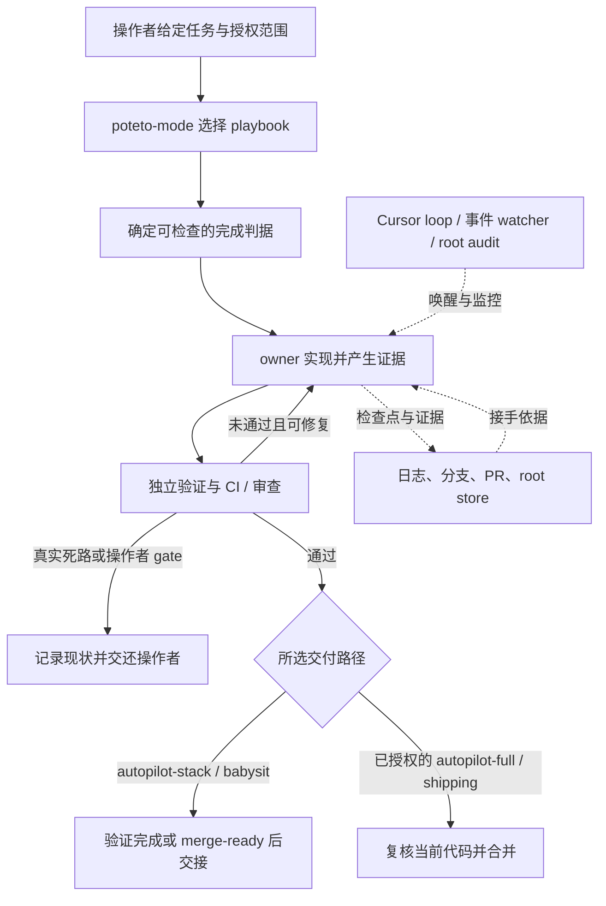

# 自用开发 skills：全量盘点与无人值守能力比较

研究日期：2026-11-15。本文是调研与待讨论建议，不代表已经选定架构或批准迁移。

## 阅读顺序与研究范围

1. 本文：先理解两套体系的组织方式、自动化边界和取舍方向。
2. [Matt 全量清单](2026-11-15-mattpocock-skills-inventory.md)：逐项用途、触发场景、输出和交互点。
3. [pstack 全量清单](2026-11-15-pstack-skills-inventory.md)：逐项 skills、principles、playbooks 和支撑组件。
4. [设计讨论记录](../design/development-skills-session.md)：用户已确认的需求、待决问题和后续设计树。

源码快照：

| 来源 | 固定版本 | 盘点口径 |
| --- | --- | --- |
| [mattpocock/skills](https://github.com/mattpocock/skills/tree/5863806dd4e15c63174bee4e7515a4256792ecfa) | `5863806dd4e15c63174bee4e7515a4256792ecfa`，plugin 1.3.2 | 全仓 39 个 `SKILL.md`，包含正式及 beta 内容 |
| [cursor/plugins/pstack](https://github.com/cursor/plugins/tree/bf0c7cd80abdbf7fe47b634978a7d1b4071f71a7/pstack) | `bf0c7cd80abdbf7fe47b634978a7d1b4071f71a7`，plugin 0.15.42 | 主 skills 目录 58 项，其中 34 个工作流/工具 skill、24 个 principle；另有 dormant automation 目录中的 3 个 skill；23 个 playbook 不另计为 skill |

实际读取固定 commit 的源码，未安装、执行或试跑上游工作流。因此本文能证明流程写了什么、脚本实现了什么，不能证明其无人值守成功率或代码质量提升幅度。GitHub 页面缓存与实际 main 内容存在差异，以这些快照为准。

## 已确认的用户需求

- 同时面向 Codex 和 Claude Code。
- 当前主要使用 Matt 的体系。
- 主要负担是需要人手动挑选和串联 skills；grilling 的交互也过重。
- 希望自动生产高质量代码，并在无人值守时继续开发。
- 后续讨论已确认：默认交付已验证、已独立审查的 PR，明确授权时可自动合并；部署未纳入该决定。首版覆盖用户启动的单项任务持续推进，自动接单与跨进程自动恢复留待后续。
- 后续讨论已确认：常规澄清只处理缺失的产品/验收决定和不可逆取舍；完整 grilling 仅在用户明确要求深挖时启用。具体分组取舍仍待讨论，见[设计记录](../design/development-skills-session.md)。

## 首要结论

Matt 的基本单位是可组合的独立能力：澄清、写规格、拆票、实现、审查等。pstack 则把一套作者工作方式集中到 `poteto-mode`，由它路由任务、选择 playbook，再按阶段调用其他 skills。这个入口差异直接对应“谁负责串流程”的负担。依据：[Matt README](https://github.com/mattpocock/skills/blob/5863806dd4e15c63174bee4e7515a4256792ecfa/README.md)、[poteto-mode](https://github.com/cursor/plugins/blob/bf0c7cd80abdbf7fe47b634978a7d1b4071f71a7/pstack/skills/poteto-mode/SKILL.md)。

据此建议优先借用 pstack 的路由组织方式，同时按任务保留 Matt 的具体工程方法。直接把两个仓库全量叠加，很可能增加重复入口、交互和验证成本；这是一项设计判断，尚未通过实测比较。

### 本地 Matt 并非整体过时

本地 `skills-lock.json` 中 38 项均来自 Matt；与快照逐目录比较，这 38 个 skill 及支撑文件内容一致。唯一未安装的上游 skill 是 beta 的 `software-factory`。它提供软件工厂的术语、服务划分和设计问题，没有提供可运行的调度器。`loop-me` 产出工作流规格，也不是持续执行循环。依据：[software-factory](https://github.com/mattpocock/skills/blob/5863806dd4e15c63174bee4e7515a4256792ecfa/skills/in-progress/software-factory/SKILL.md)、[loop-me](https://github.com/mattpocock/skills/blob/5863806dd4e15c63174bee4e7515a4256792ecfa/skills/in-progress/loop-me/SKILL.md)；本地比对过程见 Matt 清单。

## pstack 怎样推进无人值守开发

下面是根据核心 playbooks 归纳的执行关系，不是仓库已实现的跨平台运行器：

路径依据：[poteto-mode](https://github.com/cursor/plugins/blob/bf0c7cd80abdbf7fe47b634978a7d1b4071f71a7/pstack/skills/poteto-mode/SKILL.md)、[autonomous-run](https://github.com/cursor/plugins/blob/bf0c7cd80abdbf7fe47b634978a7d1b4071f71a7/pstack/skills/poteto-mode/playbooks/autonomous-run.md)、[autopilot-full](https://github.com/cursor/plugins/blob/bf0c7cd80abdbf7fe47b634978a7d1b4071f71a7/pstack/skills/poteto-mode/playbooks/autopilot-full.md)。

### 1. 统一入口选择工作流

用户调用 `poteto-mode`，它匹配 investigation、bug fix、feature、refactoring、autonomous run 等 playbook，并将对应步骤列入 todo。大规模或没有合适 playbook 的任务交给 `figure-it-out` 设计专用流程。它不是要求用户先记住每个子 skill。来源：[入口与路由规则](https://github.com/cursor/plugins/blob/bf0c7cd80abdbf7fe47b634978a7d1b4071f71a7/pstack/skills/poteto-mode/SKILL.md)、[figure-it-out](https://github.com/cursor/plugins/blob/bf0c7cd80abdbf7fe47b634978a7d1b4071f71a7/pstack/skills/figure-it-out/SKILL.md)。

### 2. 先确定机器可检查的完成判据

`autonomous-run` 要求开始前把完成条件写成可检查的判据；每轮做证据支持的最小修改、验证、保留有效改动、撤回无效尝试。达到判据才完成，真正死路要报告，不能降低判据来结束。它没有为每种任务统一设置最大轮数或费用上限。来源：[autonomous-run](https://github.com/cursor/plugins/blob/bf0c7cd80abdbf7fe47b634978a7d1b4071f71a7/pstack/skills/poteto-mode/playbooks/autonomous-run.md)。

### 3. 唤醒与持续运行借助宿主

同一 playbook 明确使用 Cursor 内置 `/loop`。有 CI、merge 或 ref 变化事件时，使用 watcher 触发唤醒，加较长心跳兜底；没有事件时使用定时心跳。仓库也提供 GitHub PR watcher。文本规定怎样循环，宿主负责让 agent 在后续时刻继续执行。把这些 Markdown 复制到 Codex 或 Claude Code，不会一并复制 Cursor 的 `/loop`、cloud agent 或 Project store。来源：[autonomous-run](https://github.com/cursor/plugins/blob/bf0c7cd80abdbf7fe47b634978a7d1b4071f71a7/pstack/skills/poteto-mode/playbooks/autonomous-run.md)、[watch-pr 实现](https://github.com/cursor/plugins/tree/bf0c7cd80abdbf7fe47b634978a7d1b4071f71a7/pstack/skills/poteto-mode/scripts/watch-pr)。后一句是基于这些依赖的迁移判断，并非对两个目标宿主的运行测试结论。

**pstack 已有 Claude Code 适配，不能说它只支持 Cursor。** 上游维护生成的 Claude plugin 树与适配说明：Task 映射 Agent、其他 pstack skill 改为读取其文件、cloud 环境映射 worktree、不可用模型退回当前模型、Cursor-only automation 等跳过。适配表未给 Cursor `/loop` 单独提供映射，因此“可以安装使用大部分方法”和“已证明无人值守持续运行”仍是两件事。对本次目标应先复核已有 Claude 适配，再设计共享核心与 Codex 适配；不必从零重写所有映射。来源：[Claude Code adapter](https://github.com/cursor/plugins/blob/bf0c7cd80abdbf7fe47b634978a7d1b4071f71a7/pstack/docs/harness/claude-code.md)、[harness 生成器](https://github.com/cursor/plugins/blob/bf0c7cd80abdbf7fe47b634978a7d1b4071f71a7/scripts/generate-pstack-harness-trees.mjs)。这里报告的是上游适配规则，没有验证规则对当前 Claude Code 版本的准确性。

### 4. 每个 PR 由一个 owner 负责，验证另设角色

`autopilot-full` 为每个独立 PR 指派 owner，负责构建、开 PR、自证、处理 CI 与审查，授权范围内最终合并。root 组织未参与编写代码的验证者，重新运行检查、驱动真实产品并审查 diff。`orchestrate` 面向更长的项目，以 owner、verifier、必要时的 sub-coordinator 组织工作。来源：[autopilot-full](https://github.com/cursor/plugins/blob/bf0c7cd80abdbf7fe47b634978a7d1b4071f71a7/pstack/skills/poteto-mode/playbooks/autopilot-full.md)、[orchestrate](https://github.com/cursor/plugins/blob/bf0c7cd80abdbf7fe47b634978a7d1b4071f71a7/pstack/skills/poteto-mode/playbooks/orchestrate.md)。

这是一种责任分配协议。仅靠“多 agent 同意”仍不能证明代码正确；协议中真实运行与可核验证据的要求，才是适合优先迁移的部分。后一句为调研建议。

### 5. 记录证据与状态，处理掉线或停滞

`show-me-your-work` 要求按决策和检查点维护附证据的日志。`autopilot-full` 要求尽早 push、每完成一个单元再次 push，并把 agent id、状态和停滞阈值写入 root store；root 在获准后用 `/loop 1h` 审计并替换停滞 agent。`orchestrate` 区分重试原因，经过两次重试后放下该单元并重新规划。`pause-safely` 与 `session-pickup` 规定暂停和接手时该保留、读取什么。这些不能等同于已经跨平台实现的事务恢复或守护进程。来源：[决策日志](https://github.com/cursor/plugins/blob/bf0c7cd80abdbf7fe47b634978a7d1b4071f71a7/pstack/skills/show-me-your-work/SKILL.md)、[autopilot-full](https://github.com/cursor/plugins/blob/bf0c7cd80abdbf7fe47b634978a7d1b4071f71a7/pstack/skills/poteto-mode/playbooks/autopilot-full.md)、[orchestrate](https://github.com/cursor/plugins/blob/bf0c7cd80abdbf7fe47b634978a7d1b4071f71a7/pstack/skills/poteto-mode/playbooks/orchestrate.md)、[pause-safely](https://github.com/cursor/plugins/blob/bf0c7cd80abdbf7fe47b634978a7d1b4071f71a7/pstack/skills/poteto-mode/playbooks/pause-safely.md)。

### 6. 根据授权选择交付终点

| 路径 | 实际终点 | 关键边界 |
| --- | --- | --- |
| `babysit` | PR 达到 merge-ready | 明确不因 babysit 自动获得合并授权 |
| `autopilot-stack` | 所有 PR 在当前 head 已验证且检查通过，交给操作者 | 不合并；交接后没有操作者许可不能继续 push |
| `shipping` | 自下而上合并连续已验证的 PR 段 | 每 PR 需要独立验证；第一个未验证 PR 阻断上层；读取 forge 确认真正 merged |
| `autopilot-full` | 授权队列中的 PR 推进到合并 | 操作者的 gate 优先；队列外 PR 和操作者保留项止于 merge-ready；不能绕过 forge 审批 |
| `orchestrate` | 多日项目持续协调、验证和落地 | 更强的调度与持久状态依赖，不能按普通单任务理解 |

来源：[babysit](https://github.com/cursor/plugins/blob/bf0c7cd80abdbf7fe47b634978a7d1b4071f71a7/pstack/skills/poteto-mode/playbooks/babysit.md)、[autopilot-stack](https://github.com/cursor/plugins/blob/bf0c7cd80abdbf7fe47b634978a7d1b4071f71a7/pstack/skills/poteto-mode/playbooks/autopilot-stack.md)、[shipping](https://github.com/cursor/plugins/blob/bf0c7cd80abdbf7fe47b634978a7d1b4071f71a7/pstack/skills/poteto-mode/playbooks/shipping.md)、[autopilot-full](https://github.com/cursor/plugins/blob/bf0c7cd80abdbf7fe47b634978a7d1b4071f71a7/pstack/skills/poteto-mode/playbooks/autopilot-full.md)、[orchestrate](https://github.com/cursor/plugins/blob/bf0c7cd80abdbf7fe47b634978a7d1b4071f71a7/pstack/skills/poteto-mode/playbooks/orchestrate.md)。

`poteto-mode` 的通用 Autonomy 段仍要求为部署、数据删除、客户消息、共享分支 force-push 等不可逆操作暂停。因此“自动合并”不能延伸解释成默认自动部署或任意外部写入。本次调研也不构成执行这些动作的授权。来源：[Autonomy](https://github.com/cursor/plugins/blob/bf0c7cd80abdbf7fe47b634978a7d1b4071f71a7/pstack/skills/poteto-mode/SKILL.md)。

### 7. 验证必须对应即将交付的代码

`shipping` 区分验证所覆盖的 patch 与 CI 所覆盖的 head；新 push、rebase 或底层 PR 变化后，要判断旧验证是否仍有效。它规定 patch-id 比较、部分情形重新运行，以及合并后读取平台状态。这些细节比“测试绿了就继续”更适合无人值守。来源：[shipping](https://github.com/cursor/plugins/blob/bf0c7cd80abdbf7fe47b634978a7d1b4071f71a7/pstack/skills/poteto-mode/playbooks/shipping.md)。迁移时建议先采用容易验证的保守失效规则，是否引入其复杂复用优化留待实测。

## 两套体系的能力对应与初步取舍

本表比较能力，避免把同一能力的多个 skill 名称都保留成用户入口。所有建议待用户讨论确认；未安装、删除或改写现有 skills。

| 能力 | Matt | pstack | 初步建议 |
| --- | --- | --- | --- |
| 统一开发入口 | `ask-matt` 解释流程并推荐下一步；`implement`/`implement-spec` 执行特定阶段；`wayfinder` 绘制大型探索的决策地图 | `poteto-mode` 路由并组织全程 | 优先采纳统一路由；不要让用户负责阶段衔接 |
| 需求澄清 | `grilling` + `grill-with-docs` + `domain-modeling` | 实验解决事实问题，人决定产品与偏好问题；`sharpen` 改写任务 | 保留澄清能力，按不确定性触发；完整 grilling 留作显式深挖入口 |
| 规格与拆分 | `to-spec` + `to-tickets` | playbooks、`figure-it-out`、可验证单元 | 小改动直接做；复杂任务才展开规格、依赖图与票据，避免一律走完整链 |
| 实现协调 | `implement`、`implement-spec` | feature/refactoring、autopilot/orchestrate、`swarm` | 借用依赖图和单一 owner；先用低并发验证，按工作独立性扩展 |
| 问题诊断 | `diagnosing-bugs` | bug fix、runtime/trace forensics、`why` | 合并为复现、证伪、根因、回归的专用路径 |
| 测试策略 | `tdd` 与正确测试 seam | `tdd`、验证 principles、真实产品驱动 | 按改动风险选择验证；保留行为测试与真实复现，避免为所有修改机械添加测试 |
| 架构与领域 | `codebase-design`、`domain-modeling`、`improve-codebase-architecture` | `architect`、`arena`、领域与边界 principles | 领域词汇和深模块方法作为共享参考；重要分叉再做多方案探索 |
| 独立审查 | `code-review` 的 Standards / Spec 双轴 | `interrogate`、swarm 验证、作者外 verifier | 保留需求/规范双轴，加行为证据；审查按风险分配，避免每次套全部面板 |
| 真实环境验证 | 调试反馈环、TDD、原型 | `create-verification-skill`、`maintain-verification-skill`、control-ui/cli | 优先补项目可复用的验证接口，宿主操作适配单独处理 |
| 长任务交接 | `handoff`、`claude-handoff`、beta `chief-of-staff` | 日志、session pickup、pause、root audit | 合并为明确的任务状态与恢复协议；CLI/会话工具放宿主适配层 |
| 自动审查与 CI 收尾 | `code-review`、`pr` | babysit、shipping、GitHub watcher | 借用状态与证据规则；交付终点由项目/任务授权决定 |
| 编写 skill 与改进流程 | `writing-for-agents`、`retro` | authoring/eval playbook、`reflect`、结构化原则 | 保留可维护的写作方法与评测；自动改自身流程应单独版本化并验证 |
| 写作、注释、个人风格 | `pr`、`writing-for-agents`；beta 写作系列 | `unslop`、`technical-writing`、`no-comments`、`bro` | 提炼少量共同规则，个性化格式不进入默认开发链 |
| 特殊任务与配套工具 | `teach`、课程练习、shoehorn、TS deep module 设置等 | 形式验证、视频、机器人 UI、statechart 等 | 按项目需要使用，不必作为通用开发套件的默认入口 |

以上名称的逐项源码与限制见两个全量清单。该映射为研究综合，尚未评测最优组合。

## 为什么全量照搬 pstack 可能仍然繁琐

`poteto-mode` 把人手动串联的工作转交给 agent，但同时要求较多默认仪式。例如跨函数边界先走 architect，feature 强制委派且多种实现形态触发 arena，提交/审查前走多个 prose/code cleanup skill，长任务日志另做跨模型审查。它可能减少人工操作，却增加 token、耗时和依赖。不能直接将“自动路由”理解成“更轻”。来源：[poteto-mode](https://github.com/cursor/plugins/blob/bf0c7cd80abdbf7fe47b634978a7d1b4071f71a7/pstack/skills/poteto-mode/SKILL.md)、[feature](https://github.com/cursor/plugins/blob/bf0c7cd80abdbf7fe47b634978a7d1b4071f71a7/pstack/skills/poteto-mode/playbooks/feature.md)、[show-me-your-work](https://github.com/cursor/plugins/blob/bf0c7cd80abdbf7fe47b634978a7d1b4071f71a7/pstack/skills/show-me-your-work/SKILL.md)。成本方向是基于必需步骤的推断，没有计时或计费数据。

Matt 的人工检查点也有具体出处：`to-spec` 要确认测试 seam，`to-tickets` 要批准拆分，`code-review` 缺基线或规格时会追问，多个入口标为显式调用。不能仅靠新增一个“自动化”skill 就假定这些交互都已消除。来源：[to-spec](https://github.com/mattpocock/skills/blob/5863806dd4e15c63174bee4e7515a4256792ecfa/skills/engineering/to-spec/SKILL.md)、[to-tickets](https://github.com/mattpocock/skills/blob/5863806dd4e15c63174bee4e7515a4256792ecfa/skills/engineering/to-tickets/SKILL.md)、[code-review](https://github.com/mattpocock/skills/blob/5863806dd4e15c63174bee4e7515a4256792ecfa/skills/engineering/code-review/SKILL.md)。调用标记在目标宿主中的具体行为需另行验证，不能把上游作者的解释当成跨平台保证。

还有两处值得在组合前解决的协议问题：

- **入口可见性与内部调用。** Matt 自己的 invocation 约定将 user-only skill 留给人调用；其 27 个 promoted skills 有 16 个属于此类。pstack 主目录则有 57/58 个 skill 写了 `disable-model-invocation: true`，同时由 poteto-mode 通过文件路径等方式路由。两者对于“内部调用”的组织方式不同。候选新套件需要明确哪些是用户入口、哪些是 agent 能到达的内部方法，再在两个目标宿主验收，而不能只改名称。来源：[Matt invocation 约定](https://github.com/mattpocock/skills/blob/5863806dd4e15c63174bee4e7515a4256792ecfa/.agents/invocation.md)、[pstack 入口](https://github.com/cursor/plugins/blob/bf0c7cd80abdbf7fe47b634978a7d1b4071f71a7/pstack/skills/poteto-mode/SKILL.md)；计数与各项 frontmatter 见全量清单。
- **审查覆盖范围。** Matt 的 implement 先要求 code-review，再 commit；code-review 的固定命令比较 `<fixed-point>...HEAD`，没有纳入尚未提交的工作区或暂存区。在按此顺序执行且改动还未提交时，审查可能看不到新改动。候选新套件必须明确被审查的代码快照，例如先形成 checkpoint commit，或显式审查工作区 diff。这是静态协议分析，本轮未运行重现。来源：[implement](https://github.com/mattpocock/skills/blob/5863806dd4e15c63174bee4e7515a4256792ecfa/skills/engineering/implement/SKILL.md)、[code-review](https://github.com/mattpocock/skills/blob/5863806dd4e15c63174bee4e7515a4256792ecfa/skills/engineering/code-review/SKILL.md)。

## 待确认的设计方向

建议对外只暴露一个自动开发入口，加一个明确请求时使用的深度设计入口。对内按任务选择路线，复用工程方法；每个项目声明验证方式和授权终点；宿主适配负责实际可用的委派、唤醒和恢复。此处仅是讨论候选方案。

需要逐轮决定：

1. 已确认：首版覆盖单次任务持续执行，跨进程自动恢复与自动接单留待后续。
2. 已确认：默认交付 PR，明确授权时自动合并；授权如何记录与生效仍需在后续交付组讨论。
3. 已确认原则：产品/验收与不可逆取舍追问，事实自行调查、可逆实现自行选择；当前分组细化触发和产物。
4. 哪些可观察结果构成高质量，验收任务从哪些真实项目选？
5. 小、中、大任务各自需要哪些阶段与产物？
6. 独立审查、并发、重试与预算的上限及失败出口。
7. 如何管理共享核心与 Codex / Claude Code 适配，避免两份流程发生偏移？
8. 逐项保留、合并、按需使用或不纳入新套件，最后才执行迁移。

## 建议后续用实测决定，而不是只比较文案

选取相同基线的真实任务，对现状和候选流程分别运行，检查：任务验收通过情况、真实行为验证、引入缺陷、人工介入次数、恢复成功情况、时间/资源消耗与越界改动。至少覆盖一个小 bug、一个跨层功能、一个行为保持重构、一个不可复现/缺环境任务、一次 CI 失败、一次执行中断、一次需求矛盾、一次需要人决定的产品分叉。

pstack 的 eval playbook 提供了盲评、同题比较、审查实际读取与产物的思路，可以借用；不必把指定模型和所有评测仪式直接搬进来。来源：[eval](https://github.com/cursor/plugins/blob/bf0c7cd80abdbf7fe47b634978a7d1b4071f71a7/pstack/skills/poteto-mode/playbooks/eval.md)。本轮没有执行这些评测。
